# Experiments: fold-0 runs

What failed and how it was fixed: see [Failures, fixes and retries](#failures-fixes-and-retries-lab-notebook).

These are the first four runs, trained overnight on an RTX 5060 Laptop GPU (8 GB, WSL2). All of them use the same protocol: fold-0 clips, every 5th frame, masked training images, horizontal flip + scale jitter, seed 42, AMP, and a fixed number of epochs per run. All mAP numbers below come from the **shared evaluator** (`src/evaluate.py`: COCO mAP@[.5:.95], global top-500 per image, crowd/ignore regions from the supplied GT) on the 1,625 **original** fold-0 validation frames. The official `val/` set has not been touched.

## Current table (Sat Nov 7, every run on its last epoch)

Team protocol rule (agreed Sat Nov 7): every run is reported on its **last** epoch, because Ultralytics picks `best.pt` on the same fold-0 frames we report on. The three Ultralytics runs were re-scored on `last.pt` (`tools/queue/reeval_last.py`, outputs in `outputs/<run>/last/`); the first table further down still shows their optimistic `best.pt` numbers.

| Run | Input | Epochs | mAP | AP50 | AP75 | AP_small | AP_medium | AP_large | FPS* | Train time |
|---|---|---|---|---|---|---|---|---|---|---|
| YOLO26s (smoke) | 640 | 20 | 0.168 | 0.323 | 0.156 | 0.048 | 0.130 | 0.280 | 61.6 | 0.41 h |
| YOLO26s | 1280 | 25 | 0.216 | 0.413 | 0.200 | **0.070** | 0.174 | 0.324 | 45.4 | 1.59 h |
| RT-DETR-L | 1280 | 12 | 0.179 | 0.324 | 0.175 | 0.046 | 0.145 | 0.262 | 20.0 | 2.26 h |
| **Faster R-CNN R50-FPN v2** | 1280 | 12 | **0.272** | **0.515** | **0.255** | 0.064 | **0.212** | **0.415** | 16.3 | 1.65 h |
| RetinaNet R50-FPN v2 | 1280 | 12 | 0.231 | 0.434 | 0.217 | 0.042 | 0.175 | 0.376 | 21.0 | ~1.35 h** |

\* Same FPS protocol as below; the Ultralytics FPS were re-measured with `last.pt` (another day, so ±10 %).
\** WSL crashed during epoch 3; the run resumed from the epoch-2 checkpoint (`--resume`, same seed and data order). `experiment.csv` only counts the 1.08 h after the resume.

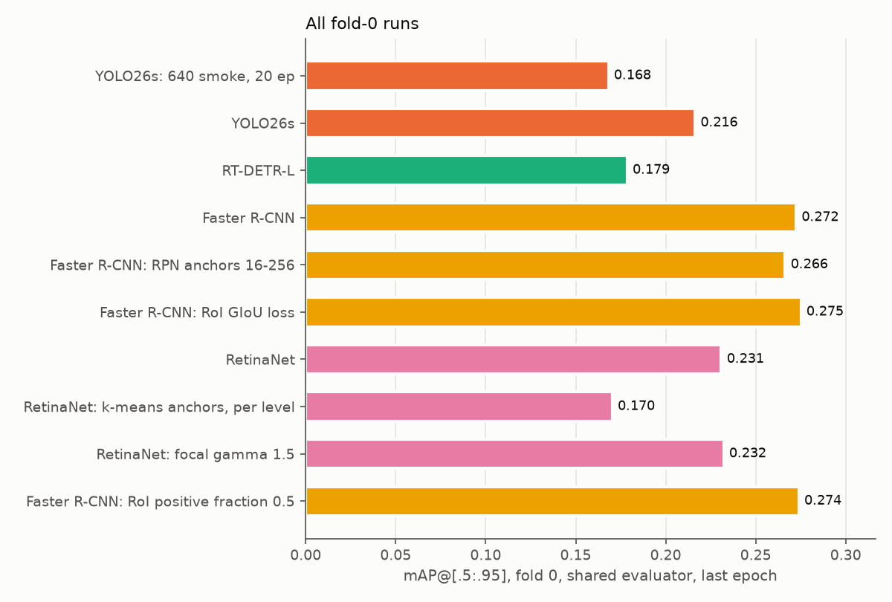

- **Re-scoring on `last.pt` costs YOLO26s 1280 two points** (0.237 → 0.216) and the smoke run 1.9 points; RT-DETR-L is unchanged (its best epoch is its last). Faster R-CNN now leads YOLO26s by 5.6 points instead of 3.5.
- **RetinaNet baseline: 0.231.** It sits between YOLO26s and Faster R-CNN and is still rising slowly at epoch 12 (0.222 → 0.226 → 0.229 → 0.231 at epochs 6/8/10/12). Its weakest point is small objects (AP_small 0.042 vs 0.064 for Faster R-CNN). This is expected from its default anchors, see below. Settings: SGD lr 0.00125 (torchvision's RetinaNet reference 0.01 @ batch 16, scaled to batch 2), otherwise the Faster R-CNN recipe.
- **Bug found and fixed while starting RetinaNet:** torchvision's RetinaNet head keeps a logit for label 0, which never gets a positive, but early in training it still emitted label-0 boxes above the 0.001 score threshold and the shared evaluator rejected them (`category_id must be in 1..8`). `tv_train.predict` now drops label 0.

## Single-knob experiments (L2–L7)

| Run | Change vs family baseline | mAP | AP50 | AP75 | AP_small | AP_medium | AP_large | Δ mAP |
|---|---|---|---|---|---|---|---|---|
| Faster R-CNN baseline | – | 0.272 | 0.515 | 0.255 | 0.064 | 0.212 | 0.415 | |
| L2 `frcnn_anchors16-256…` | RPN anchor sizes 32–512 → 16–256 | 0.266 | 0.517 | 0.241 | **0.073** | **0.216** | 0.399 | −0.006 |
| L3 `frcnn_giou…` | RoI box loss smooth-L1 → GIoU (weight 10) | **0.275** | **0.522** | 0.255 | 0.062 | 0.209 | **0.418** | +0.003 |
| RetinaNet baseline | – | 0.231 | 0.434 | 0.217 | 0.042 | 0.175 | 0.376 | |
| L4 `retinanet_kmeans…` | anchors → per-level k-means (9 shapes per level) | 0.170 | 0.388 | 0.125 | 0.060 | 0.164 | 0.233 | **−0.061** |
| L5 `retinanet_gamma1.5…` | focal loss γ 2.0 → 1.5 | 0.232 | 0.436 | 0.217 | 0.042 | 0.180 | 0.379 | +0.001 |
| L6 `frcnn_posfrac0.5…` | RoI sampler positive fraction 0.25 → 0.5 | 0.274 | 0.519 | 0.255 | 0.066 | 0.206 | **0.422** | +0.002 |

- **L2:** halving the RPN anchors trades large for small objects. AP_small +1.0 (best of all runs so far), AP50 +0.3, person/car/bicycle slightly up; but AP_large −1.6 (bus 0.49 → 0.47, truck 0.255 → 0.226) and AP75 −1.3, so the net mAP is −0.6. The two-stage head already recovers most small boxes from the low-quality RPN matches, so the anchor-coverage gain (71.7 % → 94.5 %) translates into much less than it suggests. A cheaper variant for later: keep 32–512 and add a 16 px size on P2/P3 instead of shifting every level.

- **L3:** GIoU on the RoI head (both deltas decoded against a unit box, which equals GIoU on the real boxes; weight 10 as in mmdetection) gives +0.3 mAP / +0.7 AP50, but almost all of it comes from the two rare large classes (bus +1.6, truck +1.5 mAP); the frequent classes move by ≤0.5 in either direction and AP75 is unchanged. So it does not buy the localisation gain it targets, and +0.3 is within what a different seed could give. Same speed (16.4 FPS) and train time (1.62 h). It is a free change, so it can be kept for the final Faster R-CNN, but it is not evidence by itself. TIDE on L3 (`experiments/tide_frcnn_giou/`) agrees: the Loc error impact only drops 5.1 → 4.8 AP50 points; Cls 13.4 → 12.3, Miss 6.3 → 7.0, the rest unchanged.

- **L4 failed, and the reason is a design error in the per-level anchors, not k-means as such.** AP_small rises 4.2 → 6.0 and bicycle/motor improve slightly, but AP75 drops 21.7 → 12.5 and AP_large 37.6 → 23.3 (bus 0.41 → 0.20, truck 0.20 → 0.11, van 0.24 → 0.14). It started far behind (0.107 vs 0.179 at epoch 2) and never caught up. RetinaNet's classification and box heads are **shared across P3–P7**: anchor slot *j* is the same set of conv weights on every level, so torchvision gives slot *j* the same shape relative to the stride on every level. Fitting 9 shapes independently per level broke that: slot 0 is 7×13 (tall) on P3, 33×30 (square) on P4, 161×92 (wide) on P6, so one set of weights has to regress different shapes, and the pretrained per-slot weights start from the wrong shape. Localisation quality (AP75) and the large classes suffer most, which fits. **L4b** (queued as job 72, after L6/L7) fixes this with *scale-equivariant* k-means: one set of 9 shapes fitted on boxes divided by their level's base size, placed in the pretrained slots by max IoU, times the level base (16–256) on each level. Same coverage as per-level k-means (95.0 % vs 94.9 %).

- **L5:** a softer focal loss (γ 1.5, so easy negatives are down-weighted less) changes nothing: +0.1 mAP, every class within ±0.4 except bus +1.3, same AP_small. Same speed (20.7 FPS) and train time (1.31 h). Null result; the RetinaNet gap to Faster R-CNN (4 points) is not about the classification loss.

- **L6:** twice as many positive RoIs per image in the box-head batch gives +0.2 mAP: AP_large +0.7, AP_small +0.2, AP_medium −0.6. Almost all of it is van (0.261 → 0.285); every other class moves by ≤0.7. Van is the class most confused with car (TIDE), so more positives may help the head separate them, but one class on one seed is not enough to claim it. Same speed (16.7 FPS), 1.62 h. Null to slightly positive; it could be combined with L3 in the final recipe.

## Anchors vs object size (A3)

`src/anchors_kmeans.py` measures, on 400 fold-0 training frames at the training scale (short side 720), the best IoU between each GT box and **any anchor placed where torchvision places it** (centres on each level's stride grid). A GT whose best IoU is < 0.5 only gets a positive anchor through the low-quality-match fallback.

| Anchor set | mean best IoU | GT with best IoU ≥ 0.5 | <16 px | 16–32 px | 32–64 px | ≥64 px |
|---|---|---|---|---|---|---|
| torchvision default, sizes 32–512 | 0.605 | 71.7 % | **0 %** | 60 % | 100 % | 100 % |
| sizes 16–256 (same ratios) | 0.657 | 94.5 % | 56 % | 99 % | 99 % | 99 % |
| k-means, 15 shapes split by area over P3–P7 | 0.625 | 86.5 % | 63 % | 96 % | 92 % | **47 %** |
| k-means per level (L4) (boxes → level by size, 9 shapes per level) | **0.660** | 94.9 % | 62 % | 99 % | 99 % | 98 % |
| **k-means shared across levels** (L4b: boxes ÷ level base, one set of 9 shapes × base 16–256) | 0.655 | **95.0 %** | 62 % | 99 % | 99 % | 99 % |

(GT counts per bucket: 2,088 / 8,249 / 6,744 / 1,861. Median box at training scale: 30 px.)

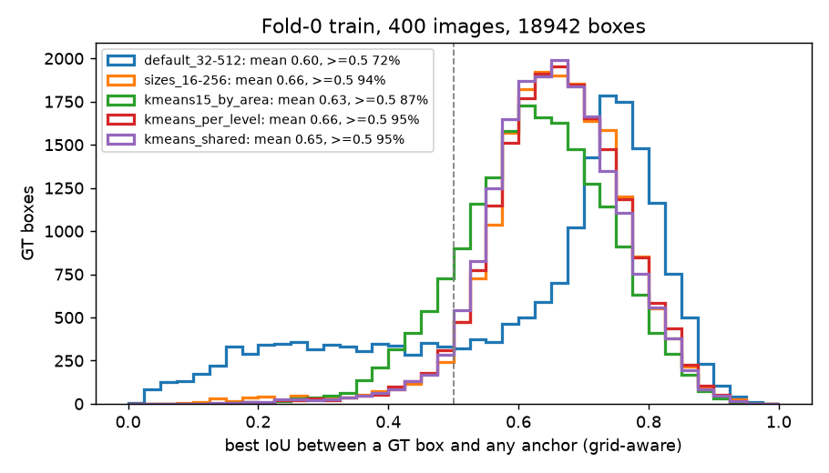

- With the default anchors, **no box under 16 px and 40 % of the 16–32 px boxes ever reach IoU 0.5 with an anchor**. That matches RetinaNet's weak AP_small and is the motivation for L2 (Faster R-CNN RPN anchors 16–256) and L4 (RetinaNet k-means anchors).
- **Plain k-means is worse than simply halving the sizes**: splitting 15 clusters over the levels by area puts mid-size boxes on coarse levels (P6/P7, stride 64/128), where the anchor grid is too sparse to reach IoU 0.5. The stride-aware variant (assign boxes to a level first, then cluster within the level) fixes that and is what L4 uses (`experiments/anchors_kmeans/anchors_kmeans_per_level.json`; P7 has only 33 boxes, so it keeps the torchvision layout at base 256).

## Error analysis of Faster R-CNN (A6, TIDE-style)

`src/tide.py` assigns every non-TP detection one error type at IoU 0.5 (TIDE definitions, t_b = 0.1) and measures how much **AP50** would rise if only that error type were fixed, with the shared evaluator (baseline AP50 0.515).

| Error | Cls | Loc | Both | Dup | Bkg | Miss | all FP | all FN |
|---|---|---|---|---|---|---|---|---|
| AP50 gain if fixed (points) | **+13.4** | +5.1 | +1.1 | +0.0 | +3.4 | +6.3 | +24.5 | +14.2 |

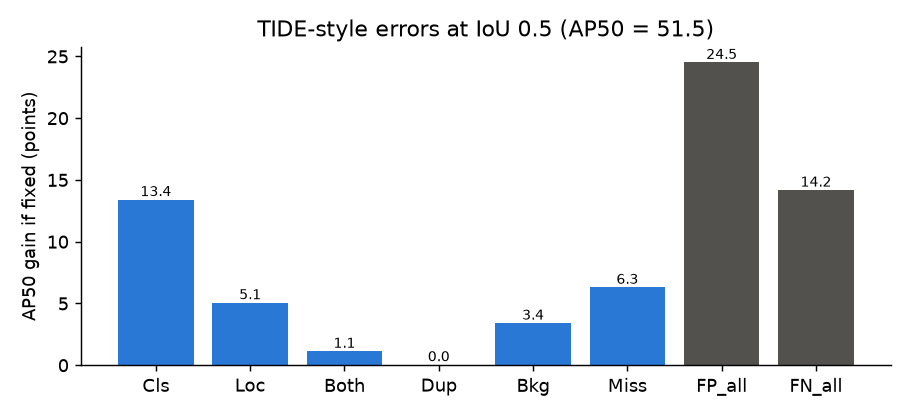

- **Class confusion is the largest error, by far.** The most frequent confusions (score-weighted): car ↔ van (both directions), motor → bicycle, person → motor / bicycle (riders), motor ↔ tricycle, truck → bus. These are visually similar vehicles at 20–40 px, plus rider-vs-vehicle boxes that overlap almost perfectly.
- **Misses (+6.3) come next.** In the failure frames below they are mostly small pedestrians and parked two-wheelers along the sidewalks of dense scenes.
- **Duplicates don't matter** (+0.0), so a looser NMS is unlikely to hurt, but class-agnostic NMS could; it would also remove real rider + motor pairs.
- Implications: class-aware ensembling (WBF) and per-class score calibration are more promising than more localisation work; small-object recall is the other lever (anchors, higher resolution, SAHI).

Failure cases (yellow: missed GT, green: TP, red: background FP, orange: localisation, magenta: wrong class, cyan: duplicate; detections with score ≥ 0.3):

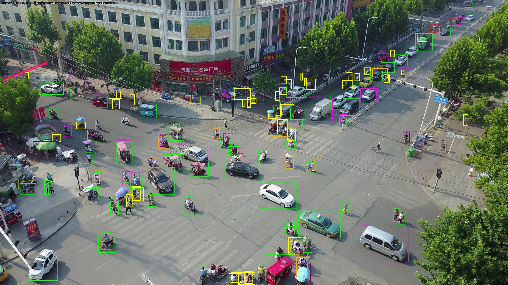
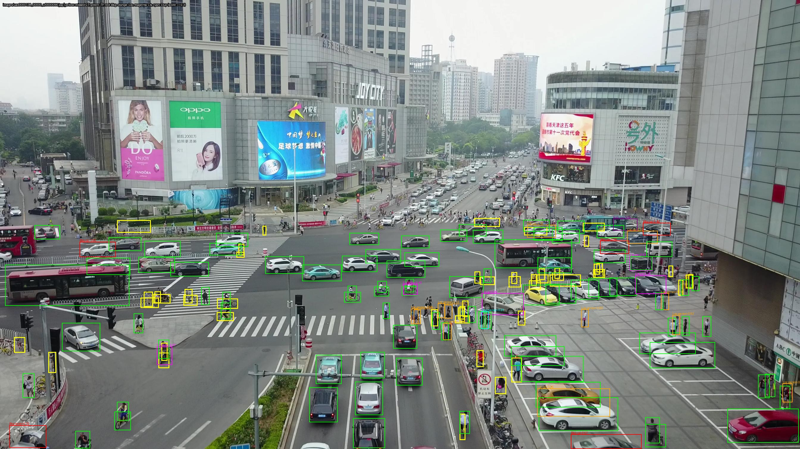
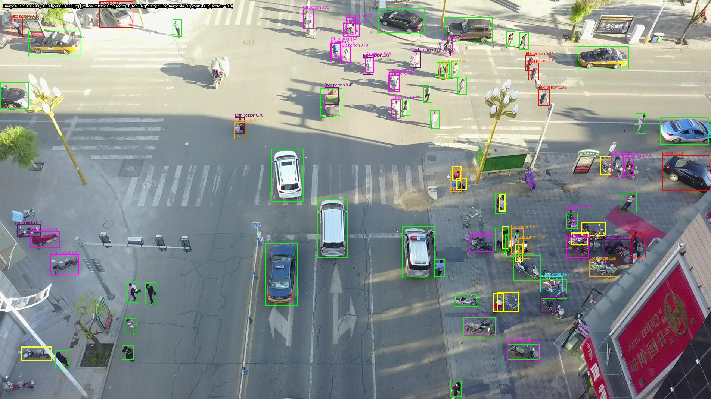

## Failures, fixes and retries (lab notebook)

Every run or step that failed, what caused it, and what was changed before the retry. Times are Kyiv time. The raw evidence is in `outputs/queue/queue.log` (START/END with exit codes) and `outputs/queue/state/<job>.log`. **Rule from now on: each new failure gets a row here, including ones that are our own mistakes.**

### Runs and jobs that failed

| When | Run / job | What happened | Cause | Fix, then retry | Outcome |
|---|---|---|---|---|---|
| Fri 22:23–22:49 | `10_yolo26s_smoke640` (YOLO26s 640 smoke) | Training finished, but the export of the validation predictions crashed: `ValueError: Prediction 498: width and height must be positive` (exit 1). | Ultralytics returned zero-area boxes (542 of 746k predictions). The shared evaluator rejects them. | `src/yolo.py` drops zero-area boxes (on `main`, commit `5c84136`). Only the post-processing was re-run (job `15_…_post`, 3 min); no retraining. | Smoke run scored (0.187 `best.pt`, 0.168 `last.pt`). The same fix protected the later YOLO and RT-DETR runs. |
| Fri | RT-DETR-L 1280, batch 4 | No error, but training was ~10× slower than expected. | The GPU ran out of its 8 GB, and the Windows driver silently spilled into shared system RAM instead of raising an out-of-memory error. | Batch 2 (`configs/rtdetr_l_base1280.yaml`). Healthy-run check added to the monitoring rules: < 7.6 GB VRAM and > 60 W. | Ran at full speed: 0.179, 2.26 h. |
| Fri | Faster R-CNN 1280, batch 4 | Out of memory in the batch probe. | Faster R-CNN at 1280 px needs more than 8 GB at batch 4. | `outputs/queue/frcnn_probe.py` caps memory at 82 % so an overflow raises an error instead of spilling, tries batch 4, then batch 2 (peak 5.3 GiB). | Batch 2 used for all torchvision runs; baseline 0.272. |
| Sat 10:12–10:18 | `50_retinanet_base1280` (L1), first attempt | Crash in the evaluator: `category_id must be in 1..8`. Job stopped (exit 143). | torchvision's RetinaNet head keeps a logit for label 0. It never gets a positive anchor, but early in training it still produced label-0 boxes above the 0.001 score threshold. | `tv_train.predict` drops label 0. Restarted from scratch at 10:19. | Fixed; also protects every later RetinaNet run. |
| Sat ~10:35 | L1 (RetinaNet baseline), second attempt | **WSL crashed** at epoch 3; all processes were killed. | **Our mistake:** we ran a test inference (`src/tv_predict.py`) next to the training process. WSL has ~10 GB RAM, and two torch processes plus data-loader workers exceeded it. | After the user restarted WSL, the job resumed from the epoch-2 checkpoint (`--resume`, same seed and data order) at 10:49. New rule: never run a second torch process during training; tests go into the queue. | Finished: 0.231. `experiment.csv` counts only the 1.08 h after the resume (real ≈ 1.35 h). |
| Sat ~14:50 | During L2 (FRCNN anchors 16–256) | No run failed, but available RAM fell below 1 GB during the validation pass (2.4 GB swap used), and the system killed a background monitoring process. | Each eval forks data-loader workers on top of the ~6 GB training process. | New flag `--eval-workers` (inference only); jobs L3+ use 2 workers for evals. | No memory problems in L3–L5. |
| Sat 15:49–17:12 | `54_retinanet_kmeans` (**L4**) | Ran to the end, but scored **0.170 vs 0.231** for the baseline (AP75 0.217 → 0.125, bus 0.41 → 0.20). | **Design error** in our anchors. RetinaNet's head is shared across P3–P7, so an anchor slot must mean the same shape on every level. Per-level k-means put unrelated shapes in the same slot (tall on P3, square on P4, wide on P6). Details in *Single-knob experiments*. | `levels_from_shared_kmeans` in `src/anchors_kmeans.py`: one set of 9 shapes on stride-normalised boxes, placed in the pretrained slots by max IoU. Same coverage (95.0 % vs 94.9 %). | **Retry queued as L4b** (`72_retinanet_kmeansshared.sh`, after L6/L7). |

### Ideas that did not help (negative or null results)

| Experiment | Expected | Got | Lesson |
|---|---|---|---|
| YOLO26s fine-tuning, 25 epochs (Fri) | Steady improvement | Ultralytics val mAP peaks at epoch 1 (640) or 5 (1280), then falls slowly. Re-scored on `last.pt` it loses 2 points vs `best.pt`. | Probably lr too high for fine-tuning and/or overfitting. Follow-ups Y1/Y2 (Oleh). |
| Checkpoint choice (Fri) | – | Ultralytics `best.pt` is selected on the same fold-0 frames we report on, so YOLO/RT-DETR looked 2 points better than they are. | Protocol rule: every run is reported on its last epoch. All three Ultralytics runs re-scored (L0). |
| A3: plain k-means anchors (15 shapes split by area) | Better coverage than the defaults | 86.5 % of boxes reach IoU 0.5, worse than simply halving the anchor sizes (94.5 %); only 47 % of boxes ≥ 64 px. | Coarse levels have sparse grids: anchors have to be assigned per level first. Not trained. |
| L2: Faster R-CNN anchors 16–256 | Better small objects | AP_small +1.0, but AP_large −1.6 → mAP −0.6. | Anchor coverage (72 → 95 %) mostly doesn't matter for a two-stage detector. |
| L3: GIoU box loss | Better localisation (AP75, TIDE Loc) | mAP +0.3 only from bus/truck, AP75 unchanged, TIDE Loc impact 5.1 → 4.8. | Null result; harmless to keep. |
| L4: per-level k-means anchors | Better small objects for RetinaNet | −6.1 mAP (see the table above). | Shared heads need scale-equivariant anchors → L4b. |
| L5: focal loss γ 1.5 | More signal from hard-ish examples | +0.1 mAP, all classes unchanged. | Null result; the loss shape is not RetinaNet's bottleneck. |
| L6: RoI positive fraction 0.5 | Better recall of small/rare objects | +0.2 mAP, almost all from van (+2.4). | Null to slightly positive; possibly helps car/van separation. |

### Mistakes in our own analysis tools (caught before any number was reported)

- **TIDE score floor:** the first version of `src/tide.py` dropped detections below 0.01 score, so its baseline AP50 was ~1 point below the shared evaluator's. Fixed: default `--min-score 0`, keeping all detections.
- **TIDE `--examples 0`** drew every clip instead of none. Fixed with an early return.
- **Memory cap too tight:** TIDE on L3 crashed with `MemoryError` under a 3.5 GB virtual-memory cap. It was re-run after L4's eval with a 7 GB cap.

## First baselines (Fri night; YOLO / RT-DETR from `best.pt`)

### Summary

| Run | Input | Epochs | mAP | AP50 | AP75 | AP_small | AP_medium | AP_large | FPS* | Train time |
|---|---|---|---|---|---|---|---|---|---|---|
| YOLO26s (smoke) | 640 | 20 | 0.187 | 0.343 | 0.183 | 0.041 | 0.129 | 0.308 | 51.4 | 0.41 h |
| YOLO26s | 1280 | 25 | 0.237 | 0.453 | 0.221 | **0.075** | 0.193 | 0.329 | 40.2 | 1.59 h |
| RT-DETR-L | 1280 | 12 | 0.179 | 0.324 | 0.175 | 0.046 | 0.145 | 0.262 | 19.5 | 2.26 h |
| **Faster R-CNN R50-FPN v2** | 1280** | 12 | **0.272** | **0.515** | **0.255** | 0.064 | **0.212** | **0.415** | 16.3 | 1.65 h |

\* Batch 1, FP16, including JPEG decoding, preprocessing, inference and post-processing, measured on the RTX 5060 Laptop (the plan specifies a T4, so these numbers are only comparable with each other).
\** Long side 1280 (short side 720) at test time; during training the short side is jittered between 544 and 896.

All four runs produced a valid `submission.csv` (3,811 rows). None has been uploaded to Kaggle yet. The machine-readable table is [experiments.csv](experiments.csv).

## Validation mAP during training

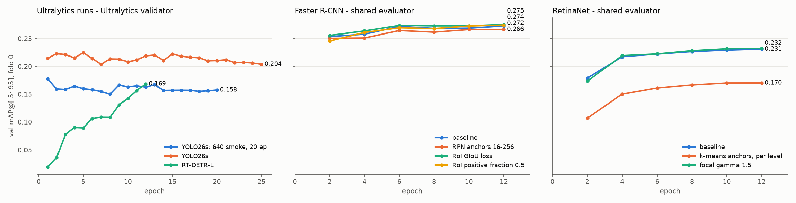

The two panels use **different evaluators** and should not be compared with each other. Ultralytics' built-in validator scores detections inside ignore regions as false positives, so it reads lower than the shared evaluator (YOLO26s 1280: 0.204 vs 0.237).

- **Both YOLO26s runs peak early and then slowly decline**: the smoke run peaks at epoch 1 of 20, and YOLO26s 1280 at epoch 5 of 25. So the COCO-pretrained model loses accuracy under this recipe. The likely causes are the auto-chosen AdamW (lr 0.00083) together with mosaic and the other default augmentations being switched off. This is worth a focused YOLO experiment.
- **RT-DETR-L is still improving steeply at epoch 12**, so it has not converged in this budget. That was expected, and the plan says to report it as such.
- **Faster R-CNN plateaus after epoch 6** (0.272 at epoch 6, 0.268–0.272 afterwards), so 12 epochs is enough for it.

> **Caveat: checkpoint selection differs between families.** The Ultralytics notebook evaluates `best.pt`, which Ultralytics picks by val mAP **on the same fold-0 frames**. The YOLO and RT-DETR numbers are therefore slightly optimistic (YOLO26s 1280 is reported from epoch 5). Faster R-CNN reports its **last** epoch. Before the final comparison, either evaluate `last.pt` for the Ultralytics runs or use the same rule for every family.

## Per-class mAP

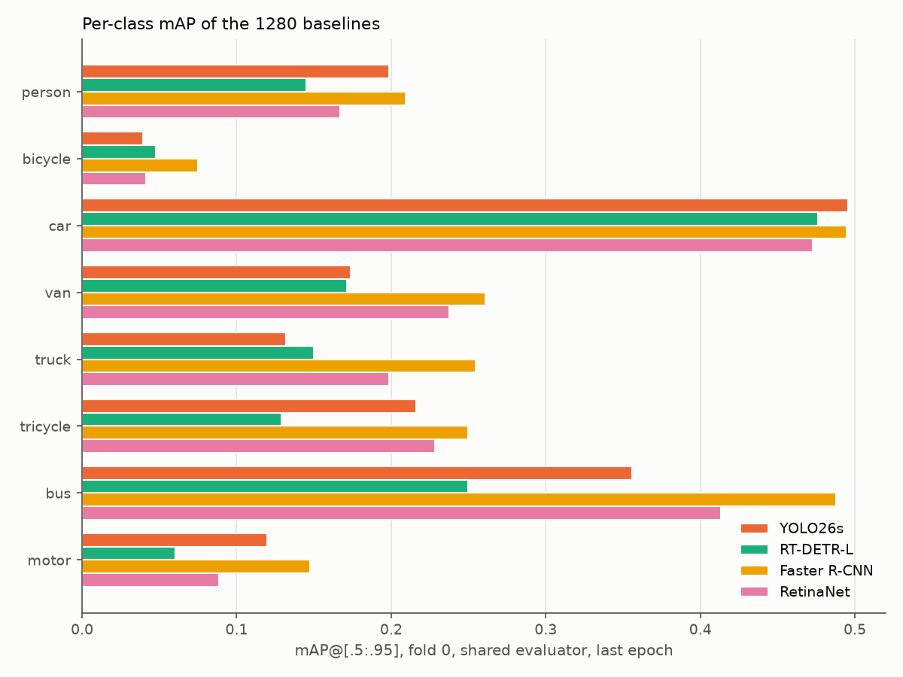

The figure shows the four 1280 baselines on their **last** epoch. Faster R-CNN leads on every class; car is a tie with YOLO26s (0.495), and person is close (0.21 vs 0.20). Its biggest margins are on the large, rare vehicle classes: bus (0.49 vs 0.41 RetinaNet / 0.36 YOLO26s), truck (0.255 vs 0.20 / 0.13) and van (0.26 vs 0.24 / 0.17). RetinaNet is second on the vehicle classes but last-but-one on person (0.17) and motor (0.09), the small classes. Bicycle is the weakest class for every model (≤ 0.075).

## Validation examples

The first frame of four fold-0 validation clips. Green boxes are ground truth; red boxes are predictions with score ≥ 0.1.

**YOLO26s 640 (smoke)**

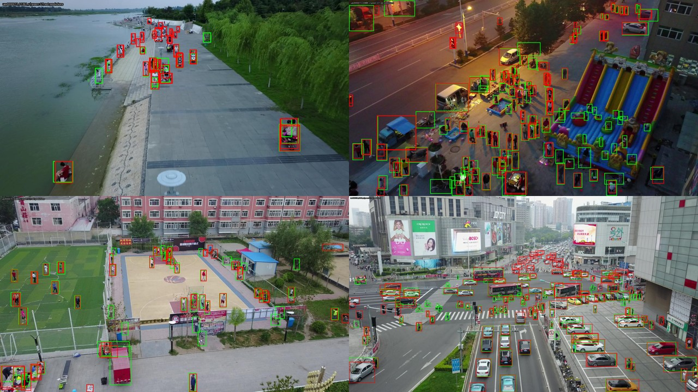

**YOLO26s 1280**


**RT-DETR-L 1280**

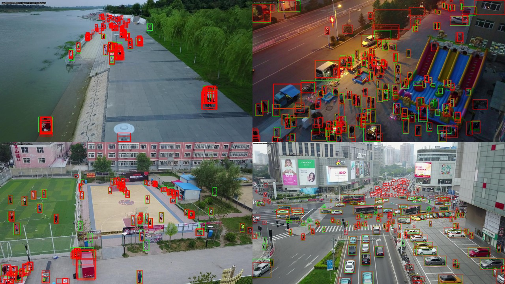

**Faster R-CNN 1280**

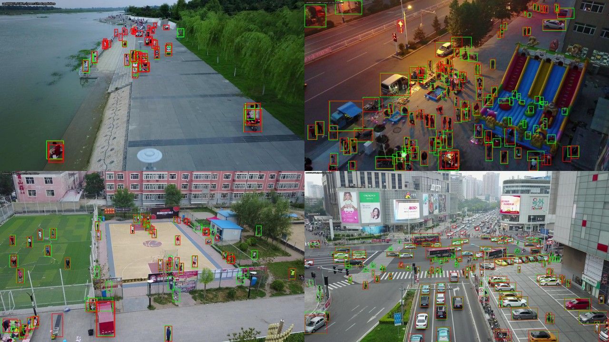

**RetinaNet 1280**

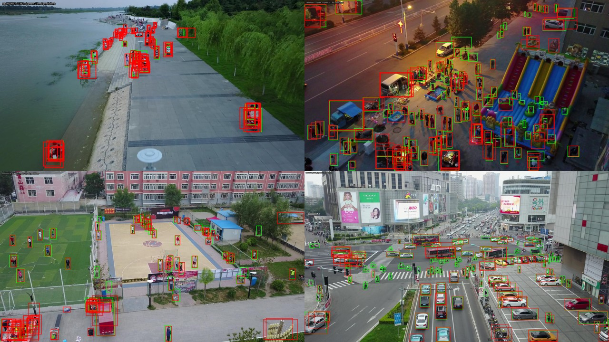

## Current pick

**Faster R-CNN R50-FPN v2 at 1280 is the current best model**: it has the highest mAP (+0.056 over YOLO26s 1280 and +0.041 over RetinaNet, all on their last epoch), the best AP50/AP75 and the best medium and large AP.

**YOLO26s 1280 is the runner-up and should stay in play**:

- it has the best AP_small, and small objects dominate this dataset;
- it is 2.5× faster;
- its own training curve suggests the recipe, not the model, is holding it back.

For the leaderboard, submit Faster R-CNN first and YOLO26s 1280 second. Because the two models are strong on different object sizes, they are natural candidates for the planned WBF ensemble.

These are single-fold, untuned baselines. Treat the ranking as provisional until the tuning experiments (L2–L5, Y1–R2) are done.

## What is where

| Path | Content |
|---|---|
| `experiments/<run>/metrics.json` | Shared-evaluator metrics, including per-class AP and detection counts |
| `experiments/<run>/experiment.csv` | One summary row; all rows are combined in `experiments/experiments.csv` |
| `experiments/<run>/results.csv`, `results.png` | Ultralytics per-epoch training and validation curves (YOLO / RT-DETR) |
| `experiments/<run>/train_log.csv` | Per-epoch losses + shared-evaluator mAP every 2 epochs (Faster R-CNN) |
| `experiments/<run>/args.yaml`, `config.json` | Exact training settings |
| `experiments/<run>/runtime.json` | Library versions and git commit |
| `notebooks/runs/*.ipynb` | Executed run copies of `notebooks/04_anchor_free_yolo.ipynb` (only the run name, config and model class changed). `yolo26s_smoke…_v1.ipynb` stops with an error at the export cell (a zero-area box, since fixed in `src/yolo.py`); `…_post.ipynb` is its rerun from the saved weights. |
| `experiments/<run>/last/` | Ultralytics runs re-scored on `last.pt` (the protocol numbers) |
| `experiments/anchors_kmeans/` | Anchor diagnostics and the k-means anchor files |
| `experiments/tide_frcnn/` | TIDE-style error breakdown + failure cases of Faster R-CNN |
| `experiments/make_summary.py` | Rebuilds this folder (files, figures, validation examples) from `outputs/`; extend `RUNS` for new runs |

Weights, predictions and submissions stay in the git-ignored `outputs/<run>/`. The `runtime.json` files record commit `eaea03e`, but the runs used the uncommitted versions of `src/tv_train.py`, `src/yolo.py` and the two new configs, which this commit adds.

### Reproduce

```bash
# Ultralytics runs: a run copy of notebooks/04 with RUN_NAME and the config path set, e.g. configs/yolo26s_base1280.yaml
# Faster R-CNN:
python -m src.tv_train --arch fasterrcnn --run-name frcnn_base_fold0_1280_e12_b2_s42_v1 --epochs 12 --batch 2 --eval-every 2 --test
python -m src.tv_train --arch retinanet --run-name retinanet_base_fold0_1280_e12_b2_s42_v1 --epochs 12 --batch 2 --lr 0.00125 --eval-every 2 --test
python tools/queue/reeval_last.py outputs/yolo26s_base_fold0_1280_e25_s42_v1 --model yolo --imgsz 1280
python -m src.anchors_kmeans
python -m src.tide outputs/frcnn_base_fold0_1280_e12_b2_s42_v1/val_predictions.json --out experiments/tide_frcnn
python experiments/make_summary.py
```
