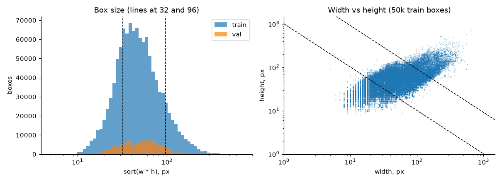
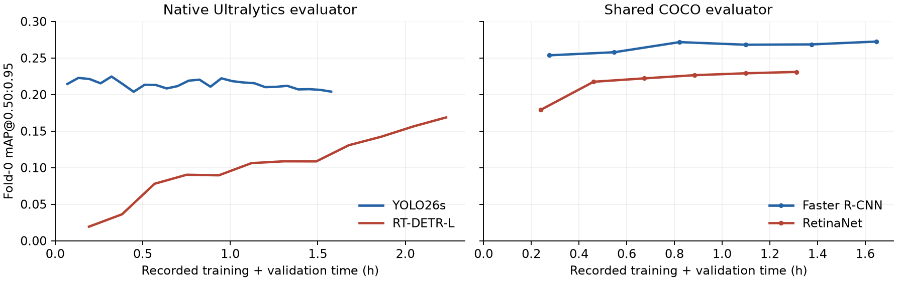
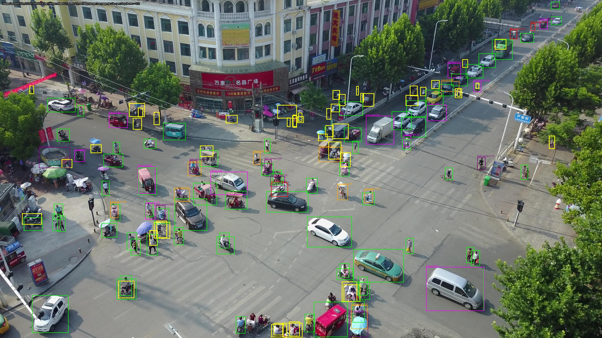
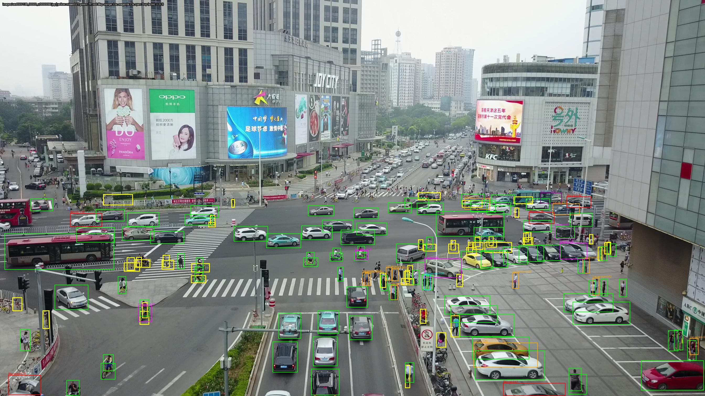
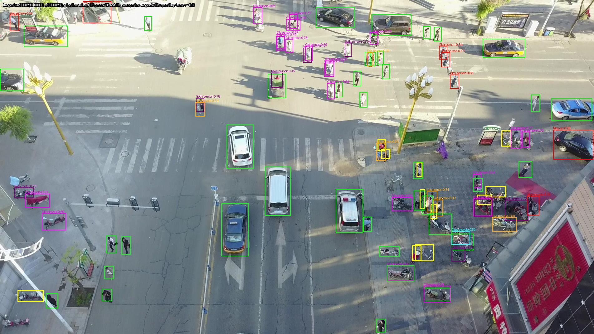

## Data and validation

We compared four detector families on eight classes: person, bicycle, car, van, truck, tricycle, bus and motor. Our best submission scored **0.308 on the public leaderboard**, against 0.2216 for the competition baseline.

There are 24,201 training frames from 56 clips, 2,846 validation frames from 7 clips, and 3,811 test frames. Cars and people make up 75% of the training boxes, and buses less than 1%. After resizing to a 1280-pixel long side, 54% of training boxes are smaller than $32^2$ pixels, and a frame has 43 objects on median (up to 180). This is why we used high-resolution inputs and tried several small-object experiments.



We split the data by video, so frames of one clip never end up in both training and validation. Fold-0 experiments used 3,243 training and 1,625 validation frames. We took every fifth frame because neighbouring frames are almost the same: a tracked box has a median IoU of 0.90 between consecutive frames and 0.60 five frames apart. We defined three folds but only had time to run experiments on fold 0.

We predicted only the eight target classes. In training images we filled the ignore regions with the mean colour, keeping the pixels of labelled objects. Evaluation used the original images and the dataset's crowd annotations. Feeding the ground truth in as predictions gives mAP ≈ 1.0, and every submission was checked for valid boxes, classes and test IDs.

## Detector comparison

All models started from pretrained weights (seed 42) with flip and scale augmentation, at about 1280 pixels on the long side. The first Ultralytics baselines had mosaic, HSV and translation turned off. Each baseline took 1.3-2.3 hours to train.

The table shows the **last checkpoint** of each model on the same fold-0 frames. mAP is averaged over IoU 0.50-0.95. Small objects are below $32^2$ pixels in the original image and large ones above $96^2$. Our evaluator follows COCO and keeps the top 500 detections per image.

| Model | mAP | AP50 | Small | Medium | Large | FPS |
|---|---:|---:|---:|---:|---:|---:|
| Faster R-CNN R50-FPN v2 | **0.272** | **0.515** | 0.064 | **0.212** | **0.415** | 16.3 |
| RetinaNet R50-FPN v2 | 0.231 | 0.434 | 0.042 | 0.175 | 0.376 | 21.0 |
| YOLO26s | 0.216 | 0.413 | **0.070** | 0.174 | 0.324 | **45.4** |
| RT-DETR-L | 0.179 | 0.324 | 0.046 | 0.145 | 0.262 | 20.0 |

FPS is measured with batch 1 and FP16 on an RTX 5060 Laptop GPU, from image decoding to post-processing. YOLO trained for 25 epochs and the others for 12.

Faster R-CNN proposes regions first and then classifies and refines them. RetinaNet classifies dense anchors directly and uses focal loss to down-weight easy background. YOLO26 has no fixed anchor shapes, so objects close together can compete for the same locations. RT-DETR matches predictions to objects one-to-one and needs no NMS. Its 300 queries are well above our maximum of 180 objects, but its curve was still rising at epoch 12 and we never ran a tuned version.



## Experiments and failures

**Faster R-CNN.** Smaller anchors (16-256 instead of 32-512) raised small-object AP to 0.073 but lowered mAP to 0.266. GIoU loss (0.275) and 50% instead of 25% positive RoIs (0.274) were within seed noise, and together they dropped to 0.268. The RoI gain also disappeared with seed 43, so we kept the baseline recipe. Without ignore masking, mAP fell to 0.266.

**RetinaNet.** Focal gamma 1.5 instead of 2 changed nothing (0.232), and lower matching thresholds (0.4/0.3 instead of 0.5/0.4) dropped it to 0.201. Our first k-means anchors were fitted per pyramid level, which was a mistake. The head is shared across levels, so an anchor slot has to mean the same shape on every level. mAP fell to 0.170. One shared set of shapes, fitted on boxes scaled to each level, brought it back to 0.200, still below the baseline. As with Faster R-CNN, better small-object anchors cost accuracy on large objects.

**YOLO.** Mixing NWD into the box loss (50% CIoU, 50% NWD, $C=12.8$) gave 0.2205, with slightly lower small-object AP and only 0.1921 on the public leaderboard. Turning mosaic, HSV and translation back on helped more: 0.2415 at epoch 25 and **0.2548 at epoch 5**, which scored **0.284 publicly**. Epoch 5 was picked after the run had finished, so this number is a bit optimistic. Both runs were trained on a Mac (MPS) and switched from batch 4 to batch 2 partway through, so the comparison is not perfectly clean.

A later run with AdamW and a shorter warmup used every second frame of all 56 training clips (12,114 images) for 8 epochs. Its epoch 5 scored 0.2128 on official validation and 0.287 publicly. Our all-clips YOLO trained with SGD had higher validation mAP (0.2270) but lower small-object AP.

TIDE-style analysis of Faster R-CNN shows how much AP50 fixing each error type would add: 13.4 points for classification, 6.3 for misses and 5.1 for localization. In the examples, magenta marks class errors, yellow misses, orange localization errors, red background and green correct detections.







## Final pipeline

The final Faster R-CNN was trained on all 12,114 frames with a low-resolution augmentation: with probability 0.3, a frame is shrunk to 640-1000 pixels wide and resized back. We added it because test frames are often smaller than training frames. For the same reason, a higher inference resolution lowered the public score from 0.213 to 0.200, even though fold-0 validation improved.

The ensemble uses five checkpoints: Faster R-CNN epochs 6 and 2, our SGD all-clips YOLO epochs 4 and 3, and the fold-0 AdamW YOLO from epoch 5. Each predicts on the plain and the mirrored image, which gives 10 prediction sets. We fuse them per class with Weighted Boxes Fusion (IoU 0.6, weight 2 for the AdamW YOLO). Then temporal rescoring blends each box's score with its best same-class match (IoU at least 0.5) in the two frames before and after it, with weight 0.15. This needs consecutive frames. On every fifth frame the objects move too far, and rescoring hurt.

| Pipeline | Official validation mAP | Public score |
|---|---:|---:|
| Final Faster R-CNN alone | 0.223 | 0.247 |
| Four sets: Faster R-CNN + YOLO, with mirroring | 0.255 | 0.270 |
| Eight sets: add earlier checkpoints | 0.267 | 0.289 |
| Eight sets + temporal rescoring | 0.268 | 0.292 |
| Ten sets + temporal rescoring | 0.271* | **0.308** |

Single models use every fifth official-validation frame and ensembles all 2,846. *The ten-set validation number is before temporal rescoring, and the public score is after it.*

Official validation was not used for training, but it guided our checkpoint and ensemble choices, and the public score guided the weights. So both numbers are a bit optimistic. We also built 12-set ensembles with the later all-clips YOLO, but have not scored them yet.

## Conclusion

Faster R-CNN was the best single detector on fold 0, but most of the final score came from training on all clips and from the ensemble: 0.247 for Faster R-CNN alone and 0.308 for the ensemble. Most anchor and loss changes were within seed noise or made things worse, and better small-object anchors always cost large-object accuracy. With more time we would run full three-fold cross-validation, tune RT-DETR and submit the 12-set ensemble.

## Reproduction

Install `requirements.txt` and a compatible PyTorch and torchvision (versions are in each run's `runtime.json`). Put Kaggle's split folders and `test_images.csv` in the repository root. Notebook `01_eda_preprocessing.ipynb` prepares the folds and data. Run `src/convert.py` with step 2 for final training and with step 5 for official validation. Training commands are in the [experiment log](https://github.com/Stalex575/ai-hw-object-detection/blob/main/experiments/README.md#reproduce). Notebook 04 picks the YOLO or RT-DETR recipe through `RUN_CONFIG`. Main runs use seed 42, and seed 43 checks repeatability.

Generate the plain and mirrored predictions with `src/tv_predict.py` and `src/yolo_final.py --hflip-only`, then replay the saved ten-set ensemble:

```python
import json, subprocess, sys
from pathlib import Path

m = json.loads(Path("experiments/final/ens10_oleh_w2_iou0.6/ensemble.json").read_text())
out = "outputs/reproduced_wbf"
subprocess.run([sys.executable, "-m", "src.ensemble", "--gt", "prep/coco/val.json",
    "--iou", str(m["iou"]), "--weights", *map(str, m["weights"]),
    "--val", *m["val"], "--test", *m["test"], "--out", out], check=True)
subprocess.run([sys.executable, "-m", "src.temporal", "--val", f"{out}/val_predictions.json",
    "--test", f"{out}/test_predictions.json", "--k", "2", "--alpha", "0.15",
    "--thr", "0.5", "--out", "outputs/reproduced_final"], check=True)
```

The submission is written to `outputs/reproduced_final/submission.csv`. Weights and raw predictions are not in Git, but the run records identify every checkpoint.

**Contributions.** Oleksandr did the EDA, the detector baselines, the anchor-based tuning and the ensemble. Oleh built the shared evaluator and submission pipeline and ran the YOLO experiments on the Mac.
